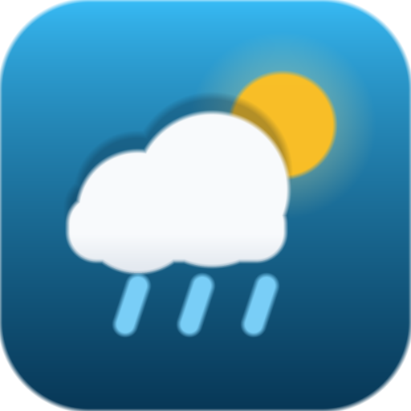

# Atmosphere Desk — weather intelligence

A single-page weather dashboard for any city on Earth: current conditions, today's
details, a 24-hour trend, a five-day outlook, air-quality breakdown and official
alerts. No framework, no build step, no account — and it keeps working when the
network does not.

**Live demo:** https://<your-github-username>.github.io/Weather/
**Run locally:** `python3 -m http.server 8080` → http://localhost:8080



---

## What makes it different

| | |
| --- | --- |
| **Never blank** | Data resolution order is live API → in-memory cache → last saved snapshot → generated demo figures, so a dead key, a rate limit or a plane ride still renders a full dashboard. |
| **Quota-aware** | Every response is cached by URL with a TTL (conditions 10 min, forecast 15 min, air quality 30 min, alerts 5 min, geocoding 24 h). Switching °C/°F re-renders instead of re-fetching. |
| **Honest numbers** | The AQI dial is computed from raw PM2.5 / PM10 concentrations against EPA breakpoints, not from a colour lookup. Dew point, gusts, "rain likely around 15:00" and 24 h precipitation are derived, and every derived value explains itself in a click. |
| **Offline-first PWA** | Installable manifest with real icons, a service worker that is network-first for the shell and stale-while-revalidate for API calls, and a snapshot of your last reading kept in `localStorage`. |
| **Alerts that actually work** | US locations use the free, key-less `api.weather.gov` feed. Everywhere else can use One Call 3.0 alerts when your key has that subscription. |
| **Keyboard and screen-reader friendly** | Skip link, focus-trapped dialogs, `aria-live` status regions, generated chart summaries, real `<kbd>` shortcuts, and a `prefers-reduced-motion` path that turns every animation off. |

## Screens

- **Header** — live status pill, condition, coordinates, data age and the source of the data.
- **Search** — city lookup with favourites/history/live geocoding merged into one combobox, voice search, geolocation, offline banner.
- **Current conditions** — temperature, feels-like reasoning, narrative summary, rain timing and a themed stage with an inline SVG mark.
- **Today's details** — pressure, visibility, cloud cover, dew point, gusts, 24 h precipitation, timezone, observation time, plus a daylight arc and a wind compass.
- **Air quality** — AQI dial, level, advice cards, per-pollutant bars graded against reference limits.
- **Advice** — suggestions generated from the actual numbers (wind, humidity, pressure trend, visibility, AQI), not from the condition string alone.
- **Alerts** — official warnings with severity, timing, area and the full text in a disclosure.
- **Favourites** — a live card per saved city (up to six in parallel, each guarded against races).
- **Five-day outlook** — daily high/low range bars, rain chance, depth and peak wind; click a day for the breakdown.
- **Next 24 hours** — eight 3-hourly slots, night-tinted, click any slot for detail.
- **Trend chart** — Chart.js when available, a hand-drawn SVG chart when the CDN is blocked.

## Setup

### 1. Serve it

Any static server works — the app needs `http://` (not `file://`) for the service
worker, geolocation and `fetch` to behave:

```bash
python3 -m http.server 8080        # or: npm start
# → http://localhost:8080
```

### 2. Add an API key (optional but recommended)

The app ships with a built-in public demo key so it works the moment you open it.
Shared keys get rate limited, so for anything you publish, use your own:

1. Create a free key at <https://home.openweathermap.org/api_keys>
   (the Free tier covers `2.5/weather`, `2.5/forecast` and `data/2.5/air_pollution`).
2. Open the dashboard → **Settings → OpenWeather API key** → paste → **Test key** → **Save**.
   The key is stored only in that browser's `localStorage`.

Other ways to supply a key, in the order they are resolved:

```text
1. localStorage              — set from the Settings dialog
2. ?apikey=…  in the URL      — used for that page view only, never written to storage
3. window.__ATMOSPHERE_DESK__  — set from a small script tag before app.js
4. BUILT_IN_API_KEY in app.js  — the fallback above; set it to "" to force key entry
```

If no key works, the app switches to **demo mode**: the whole interface stays
explorable with generated figures, clearly labelled, until you add a key.

> New OpenWeather keys can take up to two hours to activate. That is the single
> most common cause of a "rejected key" message.

### 3. Alerts outside the United States

`api.weather.gov` needs no key and covers US points only. For the rest of the world,
enable **Settings → Fetch alerts from One Call 3.0**; that endpoint requires a paid
subscription, and a key without it simply reports "alerts unavailable" without
disturbing anything else.

## Configuration knobs

`app.js` keeps everything it needs in one block at the top:

| Constant | Meaning | Default |
| --- | --- | --- |
| `BUILT_IN_API_KEY` | Fallback key compiled into the page | demo key |
| `TTL` | Cache lifetime per endpoint | 5–1440 min |
| `REQUEST` | Timeout, retry count, cache size cap | 11 s, 2 retries, 80 entries |
| `LIMITS` | How many history/favourite/suggestion/alert items to show | 4–12 |
| `POPULAR_CITIES` | Curated starting points, with coordinates so they work offline | 16 cities |
| `POLLUTANTS` | Pollutant rows and their reference concentrations | 6 rows |

## Tests

Dependency-free, using Node's own test runner and a small DOM stub
(`tests/harness.mjs`) that boots the real `app.js` against shaped OpenWeather and
NWS payloads:

```bash
npm test
# or: node --test tests/app.test.mjs
```

39 tests cover the weather maths (EPA AQI breakpoints, dew point, day-length
approximation, daily aggregation), the degradation ladder (401 → demo, offline →
snapshot, 429 → retry), XSS-safety of rendered API strings, malformed-payload
resistance (no `NaN` or `undefined` may reach the UI), unit/theme/language
settings, deep links, favourites, and file-level consistency: every element id
the script resolves exists in the markup, every container in the HTML is
balanced, and every icon the manifest promises exists on disk.

## Icons

`favicon.ico`, `favicon.svg`, `icon-192.png`, `icon-512.png`, `maskable-512.png`
and `apple-touch-icon.png` are generated from one description of the mark:

```bash
npm run icons      # node tools/build-icons.mjs
```

The generator writes PNG bytes directly (no ImageMagick, no network, no
dependencies), supersamples for smooth edges, simplifies the mark for 16 px, and
keeps the artwork inside the 80 % safe zone for maskable shapes.

## Deploy to GitHub Pages

1. Push this repository to GitHub.
2. **Settings → Pages → Source: Deploy from a branch → `main` / `/ (root)`**.
3. Open `https://<username>.github.io/<repo>/`.

Everything uses relative paths (`styles.css`, `app.js`, `manifest.json`,
`start_url: "./index.html"`), so a project-page subdirectory works without changes.
Service workers require HTTPS, so the PWA install/offline part activates on the
published site (or on `localhost`), not from `file://`.

## Layout of the code

```text
index.html            markup + inline SVG sprite (weather and UI icons)
styles.css            design tokens, scene palettes per condition, component styles,
                      CSS-only weather effects, reduced-motion/print/responsive rules
app.js                one strict-mode IIFE: config, storage, networking, weather maths,
                      rendering, charts, interactions
service-worker.js     network-first shell, stale-while-revalidate API and fonts
manifest.json         installability, icons, app shortcuts
tools/build-icons.mjs icon generator (writes the PNG/ICO/SVG files)
tests/                node:test suite + DOM stub and fixtures
```

`app.js` is organised top-down: configuration → utilities → storage → units and
formatting → API key → networking → weather maths → demo generator → state →
rendering → data loading → timers → settings → interactions → PWA → boot. Each panel
has one `render…` function that takes data and writes text; nothing reaches the DOM
through an unescaped string.

## Accessibility notes

- The dialog traps focus, closes on <kbd>Esc</kbd>, marks the background `inert`
  where supported and returns focus to the control that opened it.
- Charts are `<canvas role="img">` with a generated `aria-label`, and the same
  summary is duplicated in a screen-reader-only node.
- The city field is a proper `combobox` with `aria-expanded` /
  `aria-activedescendant`, driven by arrow keys.
- Weather effects are decorative (`aria-hidden`), stop when the tab is hidden, and
  are removed entirely under `prefers-reduced-motion`; they can also be switched off
  in Settings.
- `prefers-contrast: more` and `prefers-reduced-transparency: reduce` flatten the
  glass surfaces.

## Privacy

The page talks to exactly two hosts: `api.openweathermap.org` (weather, air
quality, geocoding) and `api.weather.gov` (US alerts). Coordinates are rounded to
four decimals (~11 m) before they leave the browser, history and favourites live in
`localStorage` only, and there is no analytics, cookie banner or account.

## Troubleshooting

| Symptom | What is happening |
| --- | --- |
| "Demo mode" banner | The key was rejected, missing or unreachable. Add your own in Settings. |
| "Rate limit reached" | Free tier allows ~60 calls/min; the app already retries with backoff and caches aggressively. |
| Alerts say "unavailable" | Expected outside the US without a One Call subscription. |
| Stale-looking numbers | The updated label turns amber after an hour; press <kbd>R</kbd>. |
| Install button missing | Needs HTTPS (or localhost) and a visited second load, per browser rules. |
| Chart is a simple line drawing | The Chart.js CDN was blocked; the SVG fallback is intentional. |

## Licence

MIT. Weather data © OpenWeatherMap; US alerts © NOAA/NWS.
